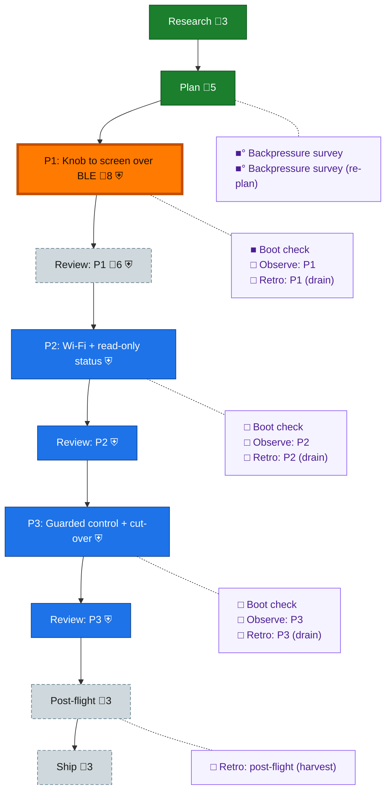

<!-- GENERATED by `harness flow render` — do not hand-edit; regenerate from the flow JSON. -->
# Flow · esp32-bridge

**Kind**: flight-plan · **Now**: phase-1 · **Intent**: Run the bluos-knob daemon on the USB-connected M5 ESP32 (ESP32-PICO-D4), with a meaningful on-device screen while running · **Nodes**: 22 · **Events**: 27

**Rail**: ◆─◆─[ ◐─◇─◇─◇─◇─◇─◇ ]─◇  ◆ Research · ◆ Plan · [ ◐ P1: Knob to screen over BLE · ◇ Review: P1 · ◇ P2: Wi-Fi + read-only status · ◇ Review: P2 · ◇ P3: Guarded control + cut-over · ◇ Review: P3 · ◇ Ship ] · ◇ Post-flight

**Legend** — colour = type/status: 🟩 done · 🟢 in-progress · 🟥 blocked · 🟦 known · ⬜ assumed · 🔶 decision · 🗣 user input · 🟪 harness chore (faded = not yet done) · 🤖 companion · 🛠 worker · 🟧 current (you are here). Badges: 💬 comments · 📄 artifacts · 📝 instructions · 🧰 chore (° optional / recommended / ‼ strongly-recommended; ✓ done · ✕ skipped) · ⛨ dd gate (terminal/total from the last evaluation; ✓ = open). ⛨✓/⛨✕ = a plan-validate check gate (green / not green).

## Node log

### backpressure · Backpressure survey
- `2026-11-17T05:20:04.381Z` · agent · validation — decision:noop hook:pre-coding actual_stage:adopt missing_rung:S2-governance reason:repo unprovisioned (no .harness/engineering-harness.md; harness doctor degraded: no extensions) basis_sha256:d1017a1dccdca117d71c856f1822e044c8a273c9b967e923c952d4c4669ae014 time:2026-11-17T05:20Z

### boot-1 · Boot check
- `2026-11-17T05:23:12.549Z` · agent · validation — decision:noop hook:pre-flight phase:1 actual_stage:adopt missing_rung:S2-governance reason:repo unprovisioned (no .harness/engineering-harness.md; harness doctor degraded: no extensions) → standard testing time:2026-11-17T05:23Z

### backpressure-73da4f97208b · Backpressure survey (re-plan)
- `2026-11-17T05:22:44.126Z` · agent · validation — decision:noop hook:pre-coding actual_stage:adopt missing_rung:S2-governance reason:repo unprovisioned (no .harness/engineering-harness.md) basis_sha256:73da4f97208b2e0febecc7e050a035142eabe1fe0ee6d79a37c857e3336595da time:2026-11-17T05:27Z
