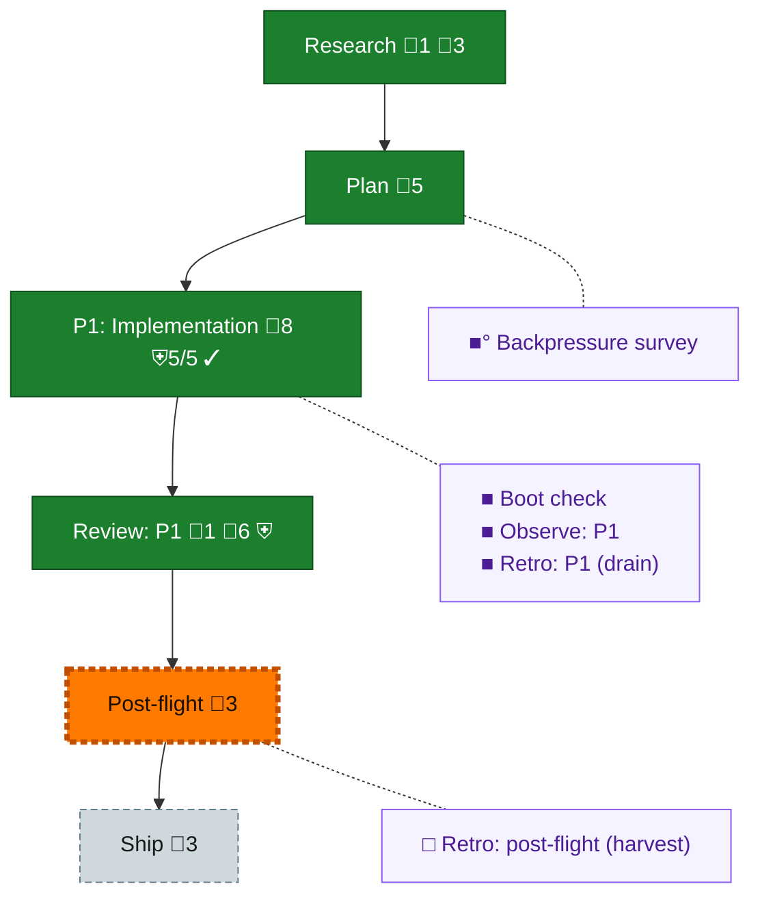

<!-- GENERATED by `harness flow render` — do not hand-edit; regenerate from the flow JSON. -->
# Flow · knob-lag

**Kind**: flight-plan · **Now**: post-flight · **Intent**: Coalesce knob clicks into one net request, keep the amp connection alive, and only redraw the screen when idle · **Nodes**: 11 · **Events**: 18

**Rail**: ◆─◆─[ ◆─◆─◇ ]─◇  ◆ Research · ◆ Plan · [ ◆ P1: Implementation · ◆ Review: P1 · ◇ Ship ] · ◇ Post-flight

**Legend** — colour = type/status: 🟩 done · 🟢 in-progress · 🟥 blocked · 🟦 known · ⬜ assumed · 🔶 decision · 🗣 user input · 🟪 harness chore (faded = not yet done) · 🤖 companion · 🛠 worker · 🟧 current (you are here). Badges: 💬 comments · 📄 artifacts · 📝 instructions · 🧰 chore (° optional / recommended / ‼ strongly-recommended; ✓ done · ✕ skipped) · ⛨ dd gate (terminal/total from the last evaluation; ✓ = open). ⛨✓/⛨✕ = a plan-validate check gate (green / not green).

## Node log

### research · Research
- `2026-11-17T22:03:40.711Z` · agent · validation — research = meeting-prime firmware diagnosis (tmwk885d1c 21:56Z) recorded in plan research_context; no dossier needed (CS-3, known code)

### review-1 · Review: P1
- `2026-11-17T22:13:59.710Z` · agent · validation — verdict:APPROVE after fixes; review: assets/tasks/phase-1/reviews/review.phase-1.md

### backpressure · Backpressure survey
- `2026-11-17T22:03:41.077Z` · agent · validation — decision:noop hook:pre-coding actual_stage:adopt missing_rung:S2-governance reason:repo unprovisioned basis_sha256:7fc526add0ce99361584792bc957b6891ee97d51a8b635949edaeb9d198f6107 time:2026-11-18T09:08+11

### boot-1 · Boot check
- `2026-11-17T22:03:41.314Z` · agent · validation — decision:noop hook:pre-flight phase:1 actual_stage:adopt missing_rung:S2-governance → standard testing time:2026-11-18T09:08+11

### observe-1 · Observe: P1
- `2026-11-17T22:13:59.108Z` · agent · validation — no new friction this phase; prior buffer retained time:2026-11-18T09:16+11

### retro-1 · Retro: P1 (drain)
- `2026-11-17T22:13:59.349Z` · agent · validation — decision:noop hook:post-coding actual_stage:adopt missing_rung:S2-governance reason:repo unprovisioned time:2026-11-18T09:16+11
