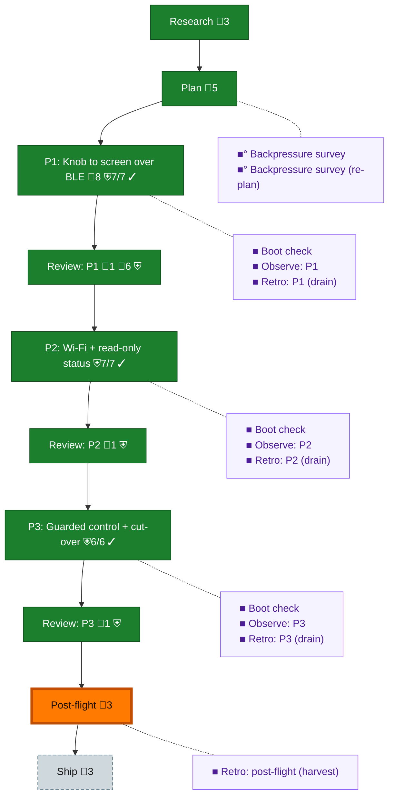

<!-- GENERATED by `harness flow render` — do not hand-edit; regenerate from the flow JSON. -->
# Flow · esp32-bridge

**Kind**: flight-plan · **Now**: post-flight · **Intent**: Run the bluos-knob daemon on the USB-connected M5 ESP32 (ESP32-PICO-D4), with a meaningful on-device screen while running · **Nodes**: 22 · **Events**: 61

**Rail**: ◆─◆─[ ◆─◆─◆─◆─◆─◆─◇ ]─◆  ◆ Research · ◆ Plan · [ ◆ P1: Knob to screen over BLE · ◆ Review: P1 · ◆ P2: Wi-Fi + read-only status · ◆ Review: P2 · ◆ P3: Guarded control + cut-over · ◆ Review: P3 · ◇ Ship ] · ◆ Post-flight

**Legend** — colour = type/status: 🟩 done · 🟢 in-progress · 🟥 blocked · 🟦 known · ⬜ assumed · 🔶 decision · 🗣 user input · 🟪 harness chore (faded = not yet done) · 🤖 companion · 🛠 worker · 🟧 current (you are here). Badges: 💬 comments · 📄 artifacts · 📝 instructions · 🧰 chore (° optional / recommended / ‼ strongly-recommended; ✓ done · ✕ skipped) · ⛨ dd gate (terminal/total from the last evaluation; ✓ = open). ⛨✓/⛨✕ = a plan-validate check gate (green / not green).

## Node log

### review-1 · Review: P1
- `2026-11-17T06:32:11.792Z` · agent · validation — verdict:APPROVE after fixes (4 findings resolved, hardware re-verified); review: assets/tasks/phase-1/reviews/review.phase-1.md

### backpressure · Backpressure survey
- `2026-11-17T05:20:04.381Z` · agent · validation — decision:noop hook:pre-coding actual_stage:adopt missing_rung:S2-governance reason:repo unprovisioned (no .harness/engineering-harness.md; harness doctor degraded: no extensions) basis_sha256:d1017a1dccdca117d71c856f1822e044c8a273c9b967e923c952d4c4669ae014 time:2026-11-17T05:20Z

### boot-1 · Boot check
- `2026-11-17T05:23:12.549Z` · agent · validation — decision:noop hook:pre-flight phase:1 actual_stage:adopt missing_rung:S2-governance reason:repo unprovisioned (no .harness/engineering-harness.md; harness doctor degraded: no extensions) → standard testing time:2026-11-17T05:23Z

### observe-1 · Observe: P1
- `2026-11-17T06:19:27.376Z` · agent · validation — captures: DL-001 (files.pythonhosted.org unreachable), DL-002 (BLE duplicate filter across scans) → .harness/temp/agent/session-buffer.md time:2026-11-17T06:20Z

### retro-1 · Retro: P1 (drain)
- `2026-11-17T06:19:27.627Z` · agent · validation — decision:noop hook:post-coding actual_stage:adopt missing_rung:S2-governance reason:repo unprovisioned (no .harness/engineering-harness.md); buffer retained at .harness/temp/agent/session-buffer.md (2 entries) for a later drain time:2026-11-17T06:20Z

### retro-harvest · Retro: post-flight (harvest)
- `2026-11-17T08:52:54.951Z` · agent · validation — decision:noop hook:post-flight actual_stage:adopt missing_rung:S2-governance reason:repo unprovisioned (no .harness/engineering-harness.md); 5 observations retained in .harness/temp/agent/session-buffer.md (DL-001..004, CONF-001, INS-001) for a future adoption harvest time:2026-11-17T09:00Z

### backpressure-73da4f97208b · Backpressure survey (re-plan)
- `2026-11-17T05:22:44.126Z` · agent · validation — decision:noop hook:pre-coding actual_stage:adopt missing_rung:S2-governance reason:repo unprovisioned (no .harness/engineering-harness.md) basis_sha256:73da4f97208b2e0febecc7e050a035142eabe1fe0ee6d79a37c857e3336595da time:2026-11-17T05:27Z

### review-2 · Review: P2
- `2026-11-17T08:12:04.207Z` · agent · validation — verdict:APPROVE; 4 findings fixed + re-verified; review: assets/tasks/phase-2/reviews/review.phase-2.md

### boot-2 · Boot check
- `2026-11-17T06:32:27.307Z` · agent · validation — decision:noop hook:pre-flight phase:2 actual_stage:adopt missing_rung:S2-governance reason:repo unprovisioned → standard testing time:2026-11-17T06:33Z

### observe-2 · Observe: P2
- `2026-11-17T08:12:03.547Z` · agent · validation — captures: DL-003 (port collision), DL-004 (heap with BLE+Wi-Fi, no soak) → .harness/temp/agent/session-buffer.md time:2026-11-17T08:12Z

### retro-2 · Retro: P2 (drain)
- `2026-11-17T08:12:03.807Z` · agent · validation — decision:noop hook:post-coding actual_stage:adopt missing_rung:S2-governance reason:repo unprovisioned; buffer retained time:2026-11-17T08:12Z

### review-3 · Review: P3
- `2026-11-17T08:52:31.903Z` · agent · validation — verdict:APPROVE after fixes (2 MEDIUM + 1 LOW fixed TDD, reflashed); plan validate --complete: 0 err 0 warn; review: assets/tasks/phase-3/reviews/review.phase-3.md

### boot-3 · Boot check
- `2026-11-17T08:12:04.725Z` · agent · validation — decision:noop hook:pre-flight phase:3 actual_stage:adopt missing_rung:S2-governance → standard testing time:2026-11-17T08:12Z

### observe-3 · Observe: P3
- `2026-11-17T08:52:01.978Z` · agent · validation — captures: INS-001 (live testing exposed muted/race gaps; fake modes made them testable) → .harness/temp/agent/session-buffer.md time:2026-11-17T08:55Z

### retro-3 · Retro: P3 (drain)
- `2026-11-17T08:52:02.245Z` · agent · validation — decision:noop hook:post-coding actual_stage:adopt missing_rung:S2-governance reason:repo unprovisioned; buffer retained (5 entries) time:2026-11-17T08:55Z
